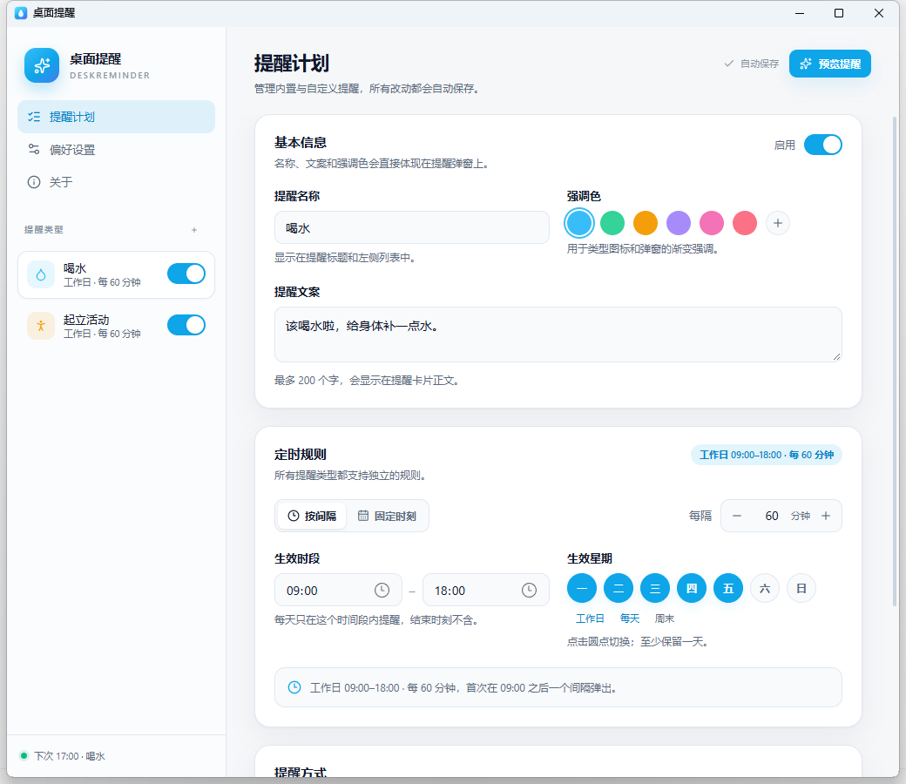
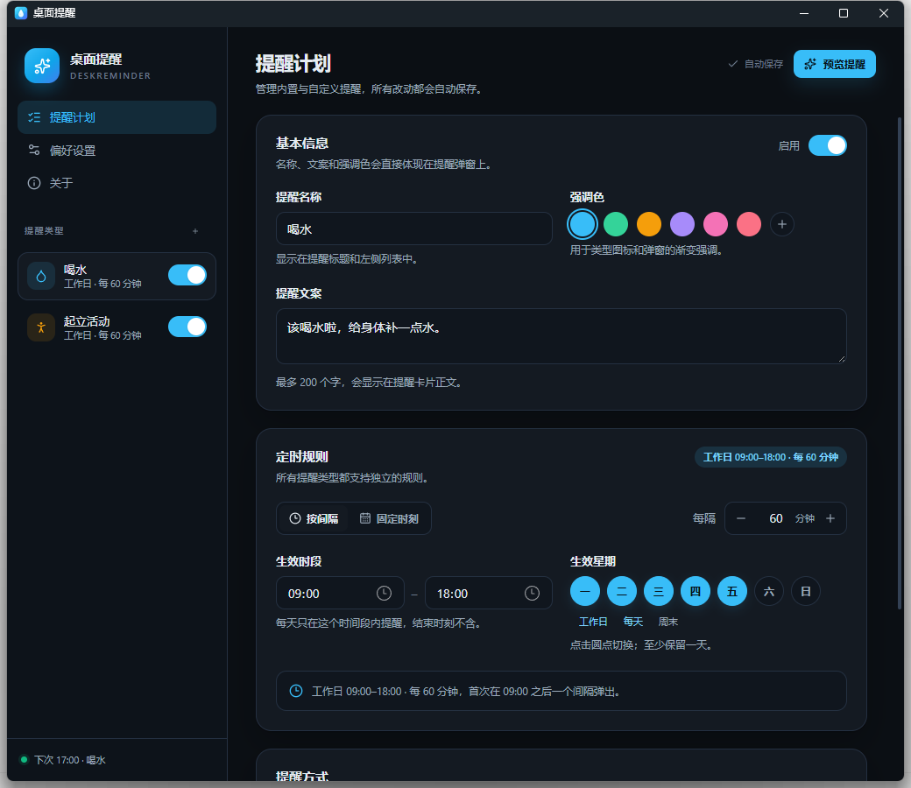

# 桌面提醒 DeskReminder

一个 Windows / macOS 的轻量桌面健康提醒工具：按自定义规则在屏幕顶部弹出卡片，提醒喝水、起立活动或任何你定义的提醒。

使用 **Tauri 2 + React 19 + Rust**，界面由系统 WebView 渲染，不附带 Chromium/Electron 内核。

## 界面截图

<p align="center">
  
</p>

<p align="center">
  
</p>

<p align="center">
  
  
</p>

## 功能

- 内置「喝水」「起立活动」，支持新增、复制、删除自定义提醒类型。
- 所有类型都支持完整自定义：
  - 名称、提醒文案、强调色、启用开关
  - 按间隔（如每 60 分钟）、固定时刻（如 09:30、11:00、15:30）或单次日期时间
  - 生效时段、生效星期
  - 弹窗停留秒数、稍后提醒分钟数
- 单次提醒：指定日期和时间只提醒一次；可开启「提醒后删除」，弹窗关闭后自动移除该提醒。
- 顶部无边框提醒卡片：滑入、倒计时进度、悬停暂停、完成/稍后、打开设置。
- 多提醒同时到期时排队展示。
- 托盘常驻：打开设置、立即提醒、暂停 30 分钟/1 小时/2 小时/今天、恢复、开机自启、退出。
- 浅色 / 深色 / 跟随系统三档主题。
- 单实例、自动保存、配置损坏自动备份。
- 锁屏和睡眠时自动静默；睡眠恢复后不补发错过的提醒。
- 完全本地运行，不联网、不上传任何数据。

## 使用

1. 安装后从桌面/开始菜单快捷方式运行，或直接运行便携版 `release\DeskReminder.exe`。
2. 首次启动会打开设置窗口；关闭窗口后程序继续驻留系统托盘。
3. 右键托盘图标可暂停、立即提醒、开机自启或退出；左键打开设置。
4. 设置修改后约 0.5 秒自动保存。非法值会标红提示，不会写入配置。

### 定时规则

- **按间隔**：在生效时段内从起点对齐。例如 09:00–18:00、每 60 分钟 → 10:00、11:00…17:00。
- **固定时刻**：按填写的时刻触发，必须落在生效时段内；多个时刻用「添加」逐个录入。
- **单次**：选择具体日期和时间，到点只提醒一次。开启「提醒后删除」时，弹窗关闭（完成、超时或稍后弹完）会自动删除该提醒；未开启时条目保留并标记「已提醒」。
- 首次提醒不会在应用启动时立即弹出，而是在下一个规则时刻触发。
- 锁屏期间到点不弹，解锁后的下一次检查会补发一次。
- 睡眠/休眠恢复后不会补发，直接重排下一次，并留 60 秒缓冲。

### 数据位置

Windows：

- 配置：`%APPDATA%\DeskReminder\config.json`
- 日志：Tauri 日志目录（通常是 `%LOCALAPPDATA%\com.deskreminder.desktop\logs\app.log`）

macOS：

- 配置：`~/Library/Application Support/DeskReminder/config.json`
- 日志：`~/Library/Logs/com.deskreminder.desktop/app.log`

配置文件损坏时会自动生成 `config.bad-时间戳.json` 备份并回退默认设置。

## 安装包（Windows）

推荐使用安装包：从 GitHub Releases 下载 `DeskReminder-Setup-1.1.0.exe`，或运行本地构建的 `release\DeskReminder-Setup-1.1.0.exe`。

安装向导支持：

- 选择安装目录（默认 `%LOCALAPPDATA%\Programs\DeskReminder`，无需管理员权限）
- 创建桌面快捷方式
- 创建开始菜单快捷方式（含卸载入口）
- 开机自动启动（登录后驻留托盘）
- 安装前检查 WebView2 Runtime，缺失时打开微软下载页
- 卸载时可选保留或删除个人配置与日志

安装包未签名，从网络下载后可能触发 SmartScreen；本机构建不受影响。

构建安装包（先构建便携版）：

```powershell
.\scripts\build-windows.ps1
.\installer\build-installer.ps1
```

输出 `release\DeskReminder-Setup-1.1.0.exe`。脚本使用 NSIS；如果本机没有 `makensis.exe`，先执行一次 `npx tauri build --bundles nsis` 下载 NSIS 工具缓存。

## GitHub Actions 自动发布

仓库包含 `.github/workflows/release.yml`。推送 `v*` 标签时，Actions 会：

- Windows：构建便携版 exe 和自定义 NSIS 安装包（安装路径、快捷方式、开机自启）。
- macOS：构建 universal `.dmg` 和 `.app.zip`（未签名）。
- 自动创建/更新 GitHub Release 并上传以上产物。

发布新版本：

```bash
git tag v1.1.0
git push origin v1.1.0
```

也可以在 GitHub Actions 页面手动触发 `workflow_dispatch`，只构建并保留 artifacts，不创建 Release。

发版前请同步更新 `package.json`、`src-tauri/Cargo.toml`、`src-tauri/tauri.conf.json` 和 `installer/DeskReminder.nsi` 中的版本号（当前 `1.1.0`）。macOS 产物默认未签名，正式分发需要 Apple Developer ID 签名和公证。

## 开发与构建

### Windows

前置条件：

- Windows 10/11
- Node.js 20+
- Visual Studio 2022 Build Tools（C++ 工作负载 + Windows SDK）
- Rust stable MSVC
- WebView2 Runtime（Windows 11 自带）

本机已使用的安装方式（脚本可复用）：

```powershell
# 需要管理员权限；会弹 UAC
.\scripts\install-windows-toolchain.ps1
```

构建：

```powershell
.\scripts\build-windows.ps1
```

产物：`release\DeskReminder.exe`（便携版）。

开发模式：

```powershell
npm install
npm run tauri dev
```

调试参数：

```powershell
.\release\DeskReminder.exe --settings   # 启动后直接打开设置
.\release\DeskReminder.exe --demo       # 启动后弹一条预览提醒
```

### macOS

macOS 版使用同一套源码（WKWebView），但必须在 Mac 上构建：

```bash
xcode-select --install
curl --proto '=https' --tlsv1.2 -sSf https://sh.rustup.rs | sh
npm ci
npm run tauri build
```

详见 [docs/macos.md](docs/macos.md)。

## 项目结构

```
src/                    React 设置页与顶部提醒视图
src-tauri/src/
  config.rs             配置模型、校验、原子保存
  schedule.rs           下一次触发时间计算
  scheduler.rs          5 秒调度循环、锁屏/睡眠/暂停处理
  state.rs              运行时状态与提醒队列
  toast.rs              顶部弹窗排队与定位
  tray.rs               托盘菜单与提示
  platform/             Win32 / macOS 平台能力
scripts/                工具链安装与构建脚本
installer/              NSIS 安装包（安装路径、快捷方式、开机自启）
design/                 应用图标与托盘模板 SVG
.github/workflows/      Windows/macOS 云端构建与 Release 发布
```

## 性能（Windows 实测）

- 便携版 exe：约 10 MB。
- 主进程常驻：约 25 MB。
- 设置页 + 提醒弹窗是两个 WebView2 实例，子进程合计约 240 MB 私有内存（工作集约 440 MB，随 WebView2 版本和系统负载波动）。
- 调度器每 5 秒做一次时间判断，只有到点才调用系统接口；空闲 CPU 接近 0。
- 单文件便携版，不写注册表（开机自启除外，且默认关闭）。

取舍：Tauri 不像 Electron 那样打包 Chromium，所以 exe 只有约 10 MB；但 WebView2 子进程的内存占用会高于原生 Win32 控件。这是现代 Web 界面的代价。若后续更看重常驻内存，可以把设置页和弹窗改成按需创建/销毁，进一步降低空闲占用。

## 已知限制

- Windows 便携版和安装包均未签名，从网络下载后可能触发 SmartScreen；本机构建不受影响。
- macOS 版未签名时首次打开需右键「打开」，或在终端执行 `xattr -dr com.apple.quarantine DeskReminder.app`。
- macOS 版代码已按跨平台方式编写，但本次开发环境是 Windows，未做 macOS 实机编译验证；首次在 Mac 上构建可能需要修少量平台代码。
- 提醒定位在主屏工作区顶部；暂不支持跟随鼠标所在屏幕。
- 提示音使用系统提示音（Windows `MessageBeep` / macOS `NSBeep`），不支持自定义音频。

## 隐私

不包含任何网络请求、统计或更新检查；所有配置和日志都留在本机。
